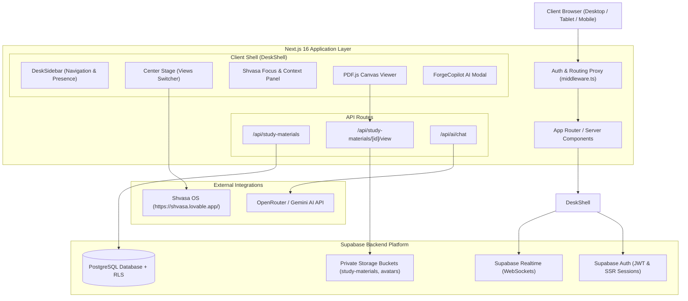
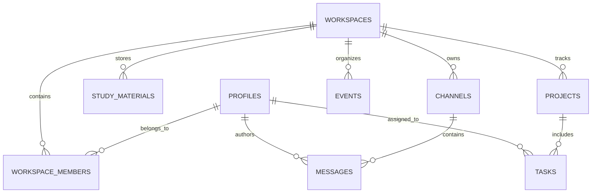

# HackForge — Technical Architecture & System Design

**Project:** HackForge Collaboration Platform  
**Target Architecture:** Next.js App Router (SSR) • Supabase PostgreSQL • Realtime • Storage • OpenRouter AI  
**Repository:** [https://github.com/DevEagleEye97/Team-Bhairava-.git](https://github.com/DevEagleEye97/Team-Bhairava-.git)  

---

## 1. System Architecture Overview

HackForge uses a modern, edge-compatible Next.js App Router architecture integrated with Supabase for data persistence, authentication, storage, and realtime messaging.

---

## 2. Technology Stack & Key Libraries

| Layer | Technology | Purpose |
|---|---|---|
| **Framework** | Next.js 16.4.2 (App Router) | High-performance React framework with server rendering and edge proxy. |
| **Language** | TypeScript 5.8 | End-to-end static type safety and contract verification. |
| **Styling** | Tailwind CSS v4 & OKLCH | High-density dark developer workspace styling without bundle bloat. |
| **UI Primitives** | shadcn/ui & Radix UI | Accessible dialogs, sheets, badges, avatars, and dropdown menus. |
| **Database** | Supabase PostgreSQL | Multi-tenant relational schema with Row-Level Security (RLS). |
| **Authentication** | `@supabase/ssr` & Supabase Auth | Cookie-based session validation and client credential isolation. |
| **Document Engine** | Mozilla `pdfjs-dist@4.4.168` | Pure HTML5 canvas PDF rendering, avoiding sandboxed iframe blocks. |
| **Realtime Engine** | Supabase Realtime | WebSocket channels for instantaneous team messaging and polls. |
| **AI Copilot** | OpenRouter / Gemini API | Server-side LLM copilot for desk summarization and task triage. |
| **Focus Companion** | Shvasa OS | Embedded breathwork, mindfulness, and Pomodoro focus timer. |

---

## 3. Database Schema & Multi-Tenant Isolation

### 3.1. Relational Entity Relationship (ERD)

### 3.2. Core Schema Entities

1. **`workspaces`**: Multi-tenant team containers (`Team Bhairava`).
2. **`profiles`**: User identities, display names, avatars, and university affiliation (`Saptagiri NPS University`).
3. **`workspace_members`**: Membership mapping with roles (`admin`, `lead`, `contributor`, `viewer`).
4. **`channels`**: Topic and study rooms (`#general`, `#hackathon-team`, `#ideas-discussions`, `#study-room`).
5. **`messages`**: Realtime team chat messages, markdown content, and code snippets.
6. **`study_materials`**: Academic repository records with semester, IA classification, storage path, and file metadata.
7. **`projects` & `tasks`**: Hackathon sprint lifecycle and task kanban records.
8. **`events`**: Curated competitions, workshops, and hackathons with registration deadlines.

---

## 4. Security & Authentication Architecture

### 4.1. Row Level Security (RLS) Protocol
- **Tenant Isolation:** Users can only query workspaces, channels, and study materials if their `auth.uid()` is an active member in `workspace_members`.
- **Private Channel Protection:** Non-members of private channels are blocked at the PostgreSQL query level.
- **Academic Storage Custody:** Storage files are kept in a private bucket (`study-materials`). Direct public URLs are disabled. Access is mediated via server-signed URLs expiring in 15 minutes.

### 4.2. Secrets Hygiene & Zero-Leakage Policy
- **Client Bundles:** Exclusively expose `NEXT_PUBLIC_SUPABASE_URL` and `NEXT_PUBLIC_SUPABASE_ANON_KEY`.
- **Server Bundles:** Sensitive keys (`SUPABASE_SERVICE_ROLE_KEY`, `OPENROUTER_API_KEY`) remain in `.env.local` and are never imported into client components.

---

## 5. API Routes Specification

### `GET /api/study-materials`
- **Query Params:** `semester`, `ia`, `subject`, `q` (search term).
- **Behavior:** Queries Supabase PostgreSQL `study_materials` table with RLS. Falls back to verified local academic seed data during cold migration phases.
- **Response:** `{ data: StudyMaterial[], count: number, source: string, databaseStatus: string }`.

### `GET /api/study-materials/[id]/view`
- **Query Params:** `format=url` (returns JSON `{ signedUrl }`) or stream (streams PDF binary directly with proper `Content-Type: application/pdf`).
- **Security:** Verifies workspace access before signing storage URL or streaming binary.

### `POST /api/ai/chat`
- **Body:** `{ message: string, history: Array<{ role: string, content: string }> }`.
- **Behavior:** Injects local desk state summary into system prompt, executes server-side call to OpenRouter/Gemini, and returns streaming or JSON response.

---

## 6. Build, Quality Assurance & Deployment Pipeline

- **Type Checking:** `npx tsc --noEmit` verified with 0 errors.
- **Linting:** `npm run lint` (ESLint 9 + Next core-web-vitals) verified with 0 warnings.
- **Production Build:** `npm run build` compiles static pages, dynamic server functions, and Turbopack output bundles.
- **Continuous Integration:** Git remote tracking linked to `origin/master` at [GitHub](https://github.com/DevEagleEye97/Team-Bhairava-.git).
